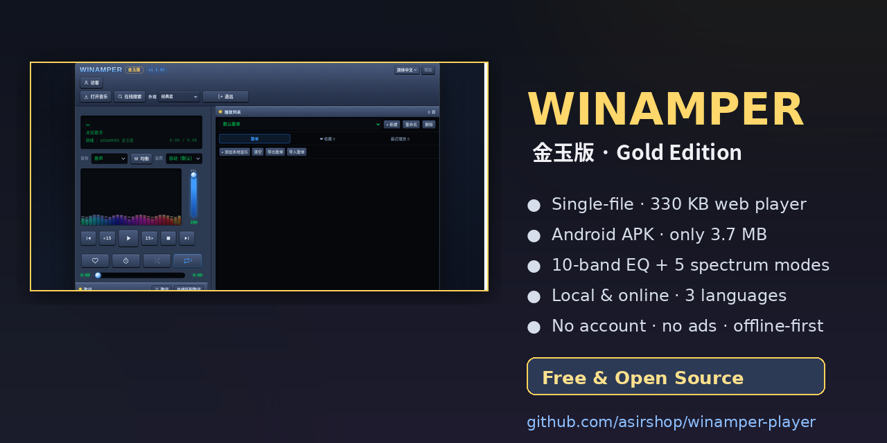

# WINAMPER 金玉版 (WINAMPER Gold)

<p align="center"></p>

**A lightweight, single-file music player for the web and Android.**
Local playback + online search, 10-band EQ, 5 spectrum visualizers, 3 languages — in a 3.7 MB APK or one 330 KB HTML file.

[中文说明](#中文说明) · [繁體中文](#繁體中文說明) · **English**

---

## Highlights

| | |
|---|---|
| **One file, no install** | The whole player is a single `index.html` (~330 KB). Open it in any browser — no server, no build step, no dependencies. |
| **Tiny Android app** | 3.7 MB APK, `minSdk 22` (Android 5.1+). Runs on old phones, car head units, TV boxes and tablets. |
| **Local + online** | Play local MP3 / FLAC / WAV / M4A / OGG with embedded cover art and lyrics, or search public music APIs. |
| **10-band equalizer** | Professional EQ with a live frequency-response curve, preamp with auto headroom, and 13 presets. |
| **5 spectrum modes** | Neon / Aurora / Ring / Flame / Stardust — GPU-cheap rendering that stays smooth even on low-end devices. |
| **Truly international** | Simplified Chinese, Traditional Chinese and English, fully translated. No account, no tracking, no ads. |
| **Private by design** | All data (users, playlists, settings) stays on your device. Nothing is uploaded. |

## Use it in your browser (no install)

Open the hosted page and start playing immediately — nothing to download:

**https://asirshop.github.io/winamper-player/**

Works on Windows, macOS, Linux, Android, iOS/iPadOS, and most smart-TV / car browsers.

> On iOS, add the page to your Home Screen for a full-screen, app-like experience.

## Download the Android APK

Grab the latest build from the [Releases](https://github.com/asirshop/winamper-player/releases) page.

- Requires Android 5.1 (API 22) or newer
- Allow "install from unknown sources" when prompted
- Internet permission is only used for online search, lyrics and cover lookup

## Features in detail

- **Playlist management** — multi-user profiles, per-user playlists, import/export, paging, long-press row menu with 6-second undo
- **Lyrics** — online lyric matching with keyword editing, `.lrc` file loading, auto-scroll, full-screen lyrics with a draggable timeline
- **Spectrum** — double-click the visualizer for a full-screen view showing the current and next lyric line
- **Online sources** — automatic source probing and failover, custom API endpoints, and a JSON subscription feed so you can host your own source list
- **Backups** — export/import all data as JSON, including local music embedded in the backup
- **Responsive** — hand-tuned layout for portrait phones, landscape phones, tablets and TV resolutions from 320 px to 1280 px+

## Building the Android app

```bash
npm install
npx cap sync android
cd android && ./gradlew assembleDebug
```

The APK is produced at `android/app/build/outputs/apk/debug/app-debug.apk`.

## Project layout

```
index.html               # The entire player (single file)
capacitor.config.json    # Capacitor configuration
package.json             # Build scripts
```

## Third-party services

Online search relies on **public, community-run music APIs**. These are not operated by this project, may rate-limit or go offline without notice, and playback URLs can expire. The player probes each source and automatically falls back to the next working one. You can add your own endpoints or a subscription feed in **API Sources**.

Please respect the copyright laws of your country when using online search.

## License

The player code is released under the **GNU Affero General Public License v3.0 (AGPL-3.0)**.

In plain words:

- ✅ **Use it, study it, modify it** — for yourself, your family, your own devices, freely.
- ✅ **Share it** — you may redistribute it, but modified versions must also be released under AGPL-3.0 with source available.
- ✅ **Run it as a service** — if you let others use your modified version over a network, you must offer them the source.
- ❌ **Closed-source rebranding is not allowed** — you may not take this code, change the name/icon and ship a closed-source product.
- ❌ **Commercial resale as a closed product is not allowed.**

The name **WINAMPER / 金玉版 / Siwey** and the app icon are not covered by the code license; please do not use them for derivative builds.

Music, lyrics and cover art retrieved from third-party sources remain the property of their respective owners.

---

## 中文说明

**单文件、免安装的轻量音乐播放器**，网页版与安卓版共用同一份代码。

### 两种用法

- **网页版（免安装）**：浏览器打开 <https://asirshop.github.io/winamper-player/> 即可使用，电脑、手机、平板、电视、车机浏览器都能跑。
- **安卓版**：到 [Releases](https://github.com/asirshop/winamper-player/releases) 下载 APK，3.7 MB，支持 Android 5.1 及以上。

### 主要功能

- 本地播放 MP3 / FLAC / WAV / M4A / OGG，自动读取内嵌封面与歌词
- 在线搜索、在线歌词匹配、自动换源、自定义接口与订阅清单
- 10 段专业均衡器（实时频响曲线、前级增益、13 个预设）
- 5 种频谱（霓虹 / 极光 / 星环 / 烈焰 / 星粒），低端机也不掉帧
- 多用户、歌单导入导出、数据备份、歌词全屏与拖动定位
- 简体中文 / 繁体中文 / English 三语，免登录、无广告、数据全部保存在本机

### 隐私

所有用户、歌单与设置都只保存在本机，不上传任何服务器。

---

## 繁體中文說明

**單檔案、免安裝的輕量音樂播放器**，網頁版與安卓版共用同一份程式碼。

- **網頁版**：以瀏覽器開啟 <https://asirshop.github.io/winamper-player/> 即可使用。
- **安卓版**：於 [Releases](https://github.com/asirshop/winamper-player/releases) 下載 APK，支援 Android 5.1 以上。

支援本機播放 MP3 / FLAC / WAV / M4A / OGG、線上搜尋與歌詞比對、10 段等化器、5 種頻譜、多使用者歌單，以及簡繁英三語介面。所有資料僅儲存於本機，不須註冊、無廣告。
